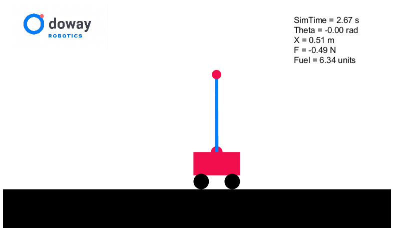
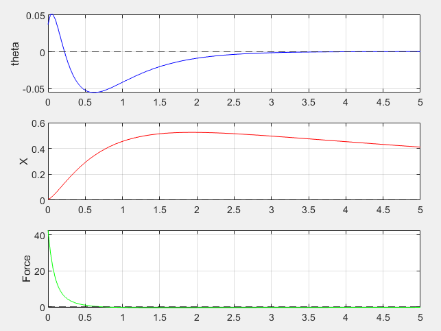

# Inverted Pendulum on a Cart Simulation

 

This project simulates a cart-pendulum system in MATLAB. It includes the math models, an animation tool, and three different controllers to balance the pendulum: PID, LQR, and Pole Placement.

## Project Files

*   **`cart_pendulum_system.m`**: The core math and physics for the simulation.
*   **`cart_pendulum_linearized_system.m`**: The linearized state-space math (A, B, C, D matrices).
*   **`draw_cart_pendulum.m`**: The animation script that draws the cart and pendulum.
*   **`pid_simulation.m`**: Runs the simulation using a PID controller.
*   **`tune_pid.m`**: Opens MATLAB's graphical app to tune PID values (Kp, Ki, Kd) using sliders.
*   **`lqr_simulation.m`** & **`main.m`**: Runs the simulation using an LQR controller.
*   **`pole_placement_simulation.m`**: Runs the simulation using Pole Placement control.

## How to Run

1.  **Start a Simulation**: Open and run `pid_simulation.m`, `lqr_simulation.m`, or `pole_placement_simulation.m` in MATLAB to watch the pendulum balance.
2.  **Adjust the LQR Cost Function**: 
    *  Change the Q and R matrix in the `lqr_simulation.m` to change the behavious of the system.
    *  Q adjusts the cost of the individual states
    *  R adjusts the cost of the control input 

3.  **Place the pole**: 
    * Change pole of the `pole_placement_simulation.m` by modifying the eigen_target to set the poles as the specified eigen values.

4.  **Tune the PID Controller**: 
    *   Run `tune_pid.m`.
    *   Use the GUI sliders to adjust the speed and overshoot.
    *   Click **Export** in the top menu to save the new controller to your workspace.
    *   Update `Kp`, `Ki`, and `Kd` in `pid_simulation.m` with your new numbers.

## Requirements
*   MATLAB
*   Control System Toolbox (required for tuning and LQR math)